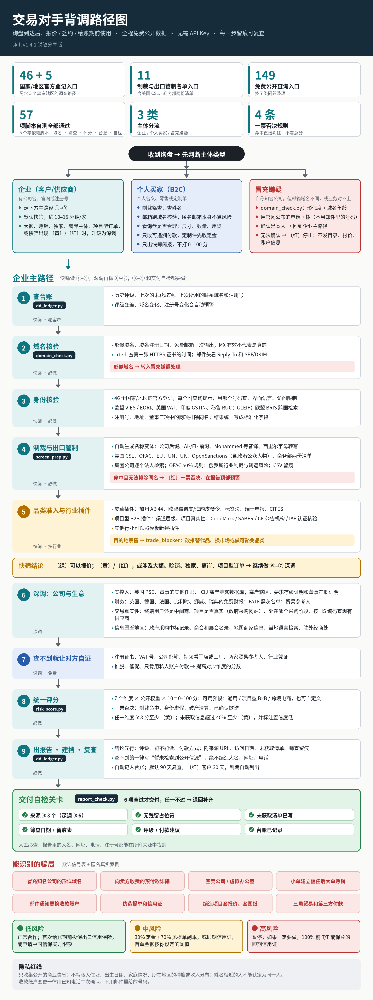

# 客户背景调查 skill（customer-background-investigation）

[](LICENSE)


对海外客户、供应商、个人买家做跨境交易风控背调，回答三个问题：这家公司真不真、这笔生意真不真、该怎么收款。用于询盘后、报价 / 签约 / 给账期之前。

- 全部使用免费公开信息源，无需 API Key
- 快速筛查约 10–15 分钟 / 家；深度尽调约 30–60 分钟
- 输出带风险评级（🟢 / 🟡 / 🔴）的快筛简报或深调报告，并建档定期复查
- 脱敏分享版：不含任何公司或个人标识

本技能只做询盘后的交易风控，不用于找新客户或写开发信。

## 调查路径



## 核心能力

- **制裁与出口管制筛查**：11 个名单入口（美国 CSL、OFAC、EU、UN、UK、OpenSanctions 等），脚本自动生成名称变体，按 OFAC 50% 规则核查股东；命中且无法排除同名即一票否决，全程留痕。
- **46 个国家/地区官方登记 + 5 个离岸辖区**：每个国家附查询提示；注册号、地址、董事三项中两项对上才认定为同一家。
- **8 大维度 + 交易真实性**：企业身份、股权与 UBO、财务信用、司法诉讼、制裁合规、经营行业、数字口碑、贸易物流；另核对终端用户还是中间商、项目是否真实、采购阶段、认证真伪。
- **仿冒邮箱识别**：根据形似度、域名注册时间、是否免费邮箱判断。
- **公开可调的评分**：7 个维度 0–100 分，提供通用、项目型 B2B、跨境电商三个预设，也可自定义（制裁权重不低于 20%）。
- **3 类主体分流**：企业、个人买家（B2C）、冒充嫌疑。
- **8 类骗局识别**，附匿名案例。
- **行业插件**：皮草与动物纤维、项目型 B2B（建材、工程、设备），其他行业可照模板扩展。
- **建档与复查**：台账自动对比历史记录并预警，默认 90 天复查，🔴 客户 30 天。
- **交付自检**：6 项清单由脚本把关，任一项不过就不交付；查不到的一律写"暂未检索到公开信源"，绝不编造。

## 安装

1. 下载 [customer-background-investigation_v1.4.1.zip](https://github.com/JanefurZhou/customer-background-investigation/raw/main/dist/customer-background-investigation_v1.4.1.zip)，或克隆本仓库：
   ```bash
   git clone https://github.com/JanefurZhou/customer-background-investigation.git
   ```
2. 把 `customer-background-investigation/` 整个文件夹放进你所用 AI 助手的技能目录（Claude、Codex、WorkBuddy、Coze 等）。
3. 首次使用先读 [SETUP.md](SETUP.md)，填写风控阈值，选择评分权重预设。
4. 在对话中说"背调""尽调""KYC""制裁筛查""这个客户靠谱吗""这个供应商可信吗"即可触发。

## 脚本

全部为纯 Python 标准库实现，共 57 项自测。

| 脚本 | 作用 | 自测 |
|---|---|---|
| `scripts/domain_check.py` | 域名与仿冒邮箱核验 | `python3 scripts/domain_check.py --selftest` |
| `scripts/screen_prep.py` | 制裁筛查名称变体、检索清单、留痕表 | `python3 scripts/screen_prep.py --selftest` |
| `scripts/risk_score.py` | 7 维度评分与一票否决 | `python3 scripts/risk_score.py --selftest` |
| `scripts/dd_ledger.py` | 背调台账、历史对比、到期复查 | `python3 scripts/dd_ledger.py --selftest` |
| `scripts/report_check.py` | 报告交付自检 | `python3 scripts/report_check.py --selftest` |

## 目录

```
SKILL.md            技能主文件
SETUP.md            首次使用配置
CHANGELOG.md        更新记录
references/         维度、免费路径、商事登记、制裁筛查、报告模板、行业插件
scripts/            5 个脚本
examples/           快筛示例、匿名案例
assets/             调查路径图
dist/               打包好的 zip
```

## 隐私与免责

- 只收集公开的商业信息；不写私人住址、出生日期，不做地区人口画像；姓名相近的人不认定为同一人。
- 本技能不对接中国信保等机构的系统，只给出申请建议；付费数据库（D&B、World-Check 等）在用户提供账号时作为补充。
- 报告是基于公开信息的风险参考，不构成法律或信用担保意见。

## 许可证

[CC BY-NC 4.0](LICENSE)：可署名后非商业性地使用、修改和分享；商业使用请先联系作者。
